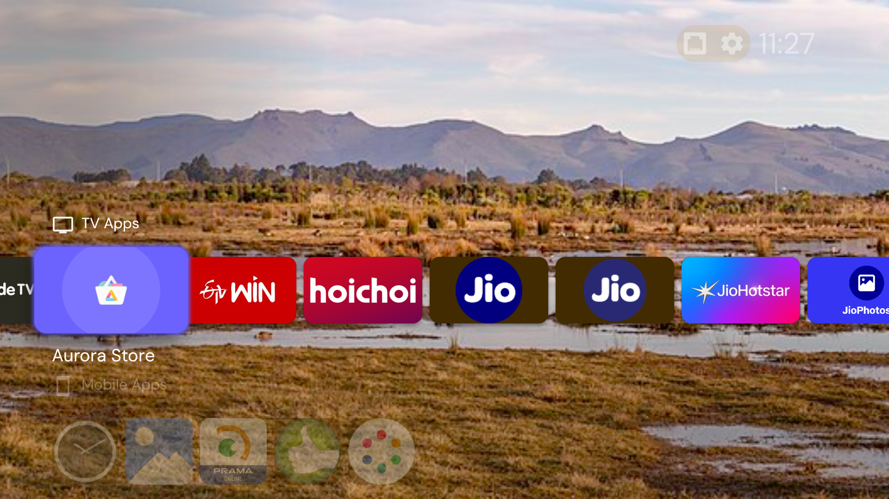
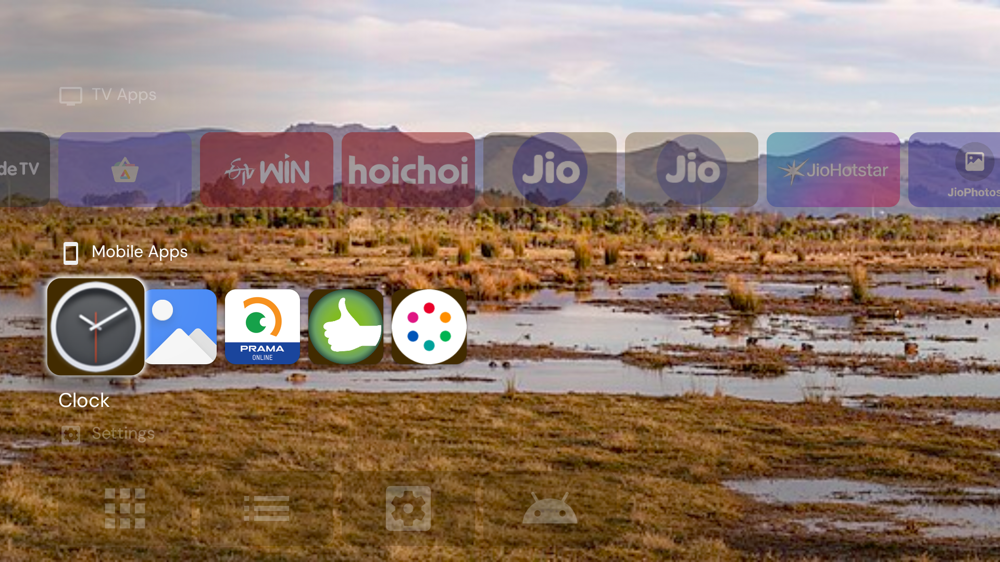

# 🛰️ FreeView-IPTV: 500+ Zero-Subscription Live Channels on Jio STB

[](#)
[](#)
[](#)
[](#)
[](LICENSE)

> **Transform your locked or ISP-restricted Reliance Jio Set-Top Box into a Universal 500+ Channel Free Satellite DTH Receiver — No JioFiber Connection, No Monthly Subscriptions, No Hidden Fees!**

---

## 📸 Screenshots Showcase

<p align="center">
  <b>Unlocked Jio STB TV Environment</b><br>
  
</p>

<p align="center">
  <b>Apps & Live TV Tools</b><br>
  
</p>

---

## 🌟 Why FreeView-IPTV?

The default **JioTV+** app on Jio Set-Top Boxes has strict server-side locks: it forces an active JioFiber/AirFiber broadband subscription and refuses playback over other internet providers (Asianet, Airtel, BSNL, Railwire, or 4G/5G mobile hotspots).

**FreeView-IPTV** completely eliminates this restriction by utilizing **TiviMate IPTV Player** paired with legally broadcast public M3U streams and EPG guides.

### ✨ Key Features
- 🆓 **100% Free & Legal:** Streams publicly accessible and open-access broadcast feeds (including Prasar Bharati DD Free Dish, major Indian news networks, and regional broadcasters).
- 🌐 **ISP Freedom:** Works flawlessly over **ANY** internet provider (Airtel, Asianet, BSNL, ACT, or mobile hotspot).
- 📡 **True Satellite DTH Experience:** Full-screen TV remote navigation with channel flipping, volume rocker control, and interactive TV Guide (EPG).
- ⚡ **Zero Lag & Hardware Accelerated:** Native decoding utilizing the Amlogic video hardware with support for 1080p Full HD streams.

---

## 📺 Channel Lineup Breakdown (500+ Channels)

### 🌴 Malayalam Channels (35+ Channels)
* **News 24x7:** 24 News, Asianet News, Manorama News, MediaOne, Mathrubhumi News, Janam TV, News18 Kerala
* **Entertainment & General:** Amrita TV, DD Malayalam, Jaihind TV, Jeevan TV, Darshana TV, CCV
* **Movies & Specials:** Asianet Movies, Flowers TV (USA), Big TV 24x7, C Malayalam TV
* **Kids & Infotainment:** Cartoon Network, Discovery Channel, Discovery Kids
* **Devotional & Religious:** Goodness TV, Harvest TV, Harvest TV Keralam, Shalom TV

### 🇮🇳 National & Hindi Channels (150+ Channels)
* **DD Network:** DD National, DD News, DD Sports, DD Kisan, DD Bharati, DD Retro, Sansad TV
* **Hindi News:** Aaj Tak, NDTV India, ABP News, Zee News, India TV, News18 India, Republic Bharat, Times Now Navbharat
* **Music & Youth:** 9XM, Mastiii, B4U Music, MTV Beats (web feeds)

### 🏏 Sports & Action (25+ Channels)
* **Live Sports:** DD Sports 1.0 & 2.0 (Live Cricket, National Sports), Red Bull TV, Olympic Channel, FIFA+, Stadium, Motorsport TV, Eurosport Free

### 🌍 Regional Indian Languages (200+ Channels)
* **Tamil (40+):** Sun News, Polimer News, Thanthi TV, Puthiya Thalaimurai, DD Podhigai, Kalaignar TV
* **Telugu (40+):** TV9 Telugu, NTV, ABN Andhra Jyothi, DD Yadagiri, DD Saptagiri
* **Kannada (25+):** TV9 Kannada, Suvarna News, Public TV, DD Chandana
* **Bengali, Marathi, Punjabi, Gujarati & Odia:** 100+ channels including DD Sahyadri, DD Bangla, Zee 24 Taas, ABP Majha.

### 🌐 Global & English News (30+ Channels)
* BBC News World, Al Jazeera English, DW News (Germany), France 24, Bloomberg TV, CNA (Singapore), Euronews, Sky News Free.

---

## ⚡ Fast Setup (One-Click Automated)

If your Jio STB has ADB enabled, simply run the provisioning script from your PC:

```bash
git clone https://github.com/dc-voltage/FreeView-IPTV-500-Zero-Subscription-Live-Channels-on-Jio-STB.git
cd FreeView-IPTV-500-Zero-Subscription-Live-Channels-on-Jio-STB
chmod +x setup_livetv.sh
./setup_livetv.sh <STB_IP_ADDRESS>
```

---

## 🛠️ Manual Step-by-Step Configuration

### 1. Install TiviMate IPTV Player
```bash
adb connect <STB_IP_ADDRESS>:5555
curl -sL -o /tmp/tivimate.apk "https://files.tivimate.com/tivimate.apk"
adb install -r /tmp/tivimate.apk
```

### 2. Push Curated Playlists
```bash
adb push playlists/malayalam_tv.m3u /sdcard/malayalam_tv.m3u
adb push playlists/india_tv.m3u /sdcard/india_tv.m3u
```

### 3. Load Playlists in TiviMate
1. Open **TiviMate** on your STB.
2. Click **"Add Playlist"** -> **"M3U playlist"**.
3. Select **"Select local playlist"** and choose:
   - 📁 `/sdcard/malayalam_tv.m3u` *(for Malayalam Channels)*
   - 📁 `/sdcard/india_tv.m3u` *(for 500+ All-India Channels)*
   *(Or enter direct URL: `https://iptv-org.github.io/iptv/languages/mal.m3u`)*
4. Name the playlist `FreeView-IPTV` and click **Done**.

### 4. Adding Interactive TV Guide (EPG)
1. Go to **Settings ⚙️** -> **TV Guide (EPG)** -> **EPG Sources** -> **Add Source**.
2. URL: `https://iptv-org.github.io/epg/guides/in.xml`
3. Save and toggle **"Update on app start"**.

---

## 🎯 Remote Control Navigation

| Remote Key | Function |
| :--- | :--- |
| **D-Pad UP / DOWN** | Change channels sequentially (DTH style) |
| **D-Pad CENTER (OK)** | Show channel quick list & preview screen |
| **D-Pad LEFT** | Open categorized channel sidebar |
| **D-Pad RIGHT** | Open Interactive TV Guide (EPG Timeline) |
| **BACK Button** | Return to full-screen video |

---

## 📜 Legal & Disclaimer
* All M3U streams and broadcast feeds are sourced from [iptv-org](https://github.com/iptv-org/iptv) under the Unlicense / Public Domain.
* Streams point exclusively to freely accessible, public live feeds provided by respective network operators.
* Licensed under the [MIT License](LICENSE).
